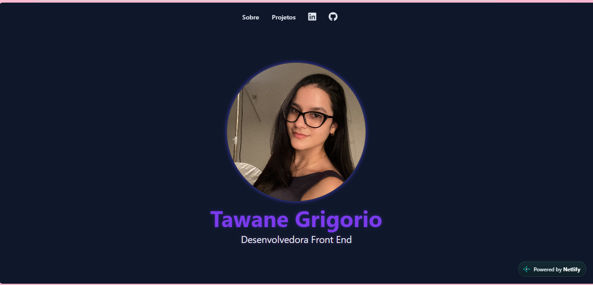

# Portfólio Pessoal — Tawane Grigorio

Projeto desenvolvido para apresentar minha trajetória de aprendizado em desenvolvimento Front-End, meus conhecimentos e os projetos que venho construindo.

## Sobre o projeto

Este portfólio reúne meus projetos práticos e apresenta minha evolução como estudante de Análise e Desenvolvimento de Sistemas.

## Tecnologias utilizadas

- HTML5
- CSS3
- JavaScript

## Objetivos do projeto

- Apresentar meus projetos de desenvolvimento web.
- Praticar a criação e estilização de interfaces.
- Aplicar conceitos de JavaScript e interatividade.
- Compartilhar minha evolução profissional na área de tecnologia.

## Acesse

- **Repositório:** https://github.com/tawanegrigorio/Portifolioemandamento
- **Portfólio online:** http://portifoliotawanegrigorio.com/

## Prévia do projeto

## Aprendizados

O desenvolvimento deste projeto contribui para meu aprendizado em estruturação de páginas, estilização, interatividade e organização de código, além de me ajudar a construir meu portfólio profissional.
